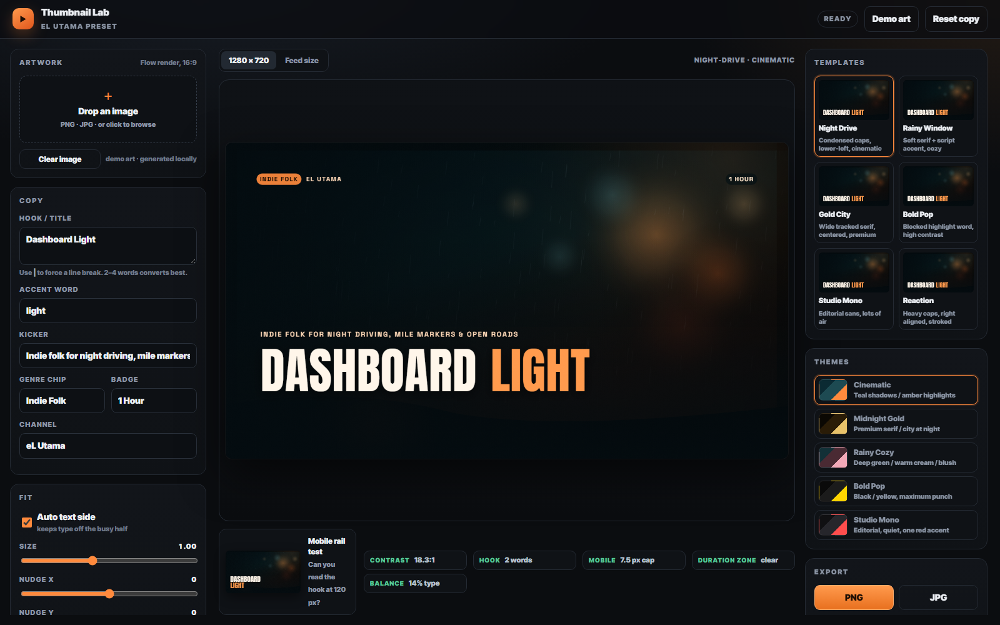

# Thumbnail Lab — eL Utama

Tool thumbnail YouTube 1280×720 dengan dua bagian:

1. **Custom Tool di Google Flow** — menghasilkan background/hero tanpa teks, 3 varian.
2. **App lokal (folder ini)** — merender tipografi presisi di atas gambar, mengecek CTR,
   dan export PNG/JPG.

Alasannya: model gambar bagus untuk foto, tapi buruk untuk teks. Semua huruf di app ini
digambar oleh canvas, jadi tajam, konsisten, dan tidak pernah salah eja.



Hasil template lain: [Midnight Gold](shots/preview-gold.png) ·
[Quiet Indie Folk](shots/preview-quiet.png) ·
[Reaction](shots/preview-reaction.png)

---

## Jalankan

```bash
npm start
```

Buka http://localhost:5177. Tidak ada dependency — hanya Node.js.

---

## Alur kerja

1. Buat background di Flow (pakai prompt di `flow-tool-prompt.md`).
2. Unduh gambar 16:9.
3. Drag ke panel **Artwork** di app.
4. Isi hook (2–4 kata), kata aksen, kicker, genre, badge.
5. Pilih satu dari 6 template dan 5 palet.
6. Cek panel CTR di bawah kanvas.
7. Export PNG, JPG, atau **Download A/B/C themes** (satu layout, tiga palet).

Belum punya gambar? Klik **Demo art** — app membuat background prosedural untuk latihan.
Dropdown **Examples…** berisi dua judul uji: Dashboard Light (Night Drive) dan
Quiet Indie Folk (Rainy Window).

---

## Template

| Template | Karakter | Cocok untuk |
|---|---|---|
| Night Drive | Anton caps, lower-left, sinematik | mix perjalanan/malam |
| Rainy Window | Playfair + script accent, hangat | indie folk, study, sleep |
| Gold City | Cormorant, wide tracking, ornamen | rilisan premium, city pop |
| Bold Pop | Archivo Black, blok kuning | video punchy, listicle |
| Studio Mono | Space Grotesk, editorial | konten minim & rapi |
| Reaction | Inter Tight 900, rata kanan | ekspresi/reaksi |

Semua template sudah punya aturan: maksimal 4 kata, area teks di sisi yang tenang,
scrim otomatis, dan sudut kanan-bawah dikosongkan untuk stamp durasi YouTube.

## Palet

Cinematic (teal/oranye) · Midnight Gold · Rainy Cozy (hijau/blush) · Bold Pop
(hitam/kuning) · Studio Mono (abu/merah).

Palet diambil dari thumbnail channel yang sudah ada supaya seri video terlihat satu
keluarga. Ganti warna di `js/presets.js` → `THEMES`.

---

## Yang dicek otomatis

- **Contrast** — rasio teks vs piksel di belakangnya (target ≥ 4.5:1). Ada tombol `fix`
  untuk menaikkan scrim.
- **Hook** — jumlah kata.
- **Mobile** — tinggi huruf saat thumbnail ditampilkan 120 px.
- **Duration zone** — teks tidak boleh masuk 24% × 16% sudut kanan-bawah.
- **Balance** — porsi area yang ditutup teks.

Preview 120 px ada di sebelah kiri panel cek — itu simulasi ukuran thumbnail di feed HP.

---

## Struktur file

```
index.html            UI 3 kolom
styles.css            tema gelap studio + @font-face lokal
js/presets.js         THEMES, TEMPLATES, DEFAULTS  ← ubah brand di sini
js/renderer.js        pipeline canvas: grade → scrim → tipografi → grain
js/app.js             input, auto-placement, cek CTR, export, ZIP A/B/C
js/zip.js             ZIP writer tanpa dependency
assets/fonts/         9 font woff2 (lokal, offline)
assets/demo/          2 thumbnail channel untuk uji layout
flow-tool-prompt.md   prompt membuat tool di Google Flow
serve.js              static server
```

### URL parameter (untuk QA/berbagi preset)

```
http://localhost:5177/?template=gold-city&theme=gold&title=Dashboard%20Light&accent=Light
```

Yang didukung: `template`, `theme`, `title`, `accent`, `subtitle`, `genre`, `badge`,
`channel`, `art` (path gambar lokal).

---

## Kustomisasi brand

Semua di `js/presets.js`:

- `DEFAULTS` — teks awal (hook, kicker, chip, badge, channel).
- `THEMES` — warna tint, accent, text, scrim, chip, badge, grain.
- `TEMPLATES` — font, ukuran, posisi, anchor, max width, gaya aksen, scrim.

Tambah palet/template baru cukup menambah objek di array; renderer otomatis memakai.

---

## Batasan yang perlu diketahui

- Semua font latin; teks panjang otomatis mengecil dan membungkus, tapi 2–4 kata tetap
  paling kuat.
- Auto side memilih sisi dengan edge energy + luminance terendah; bisa dimatikan.
- Gambar di-cover center. Untuk subjek yang harus bergeser, pakai **Nudge X/Y** pada teks,
  atau crop gambar sebelum di-drop.
- Text yang digambar model gambar tidak dipakai sama sekali — itu keputusan desain,
  bukan bug.

## Status uji

Diuji di Chrome 1280×720 dan pada preview 120 px untuk enam template × lima palet.
Export PNG/JPG dan ZIP A/B/C berjalan; font termuat lokal; tidak ada console error.
